# URL Shortener

A URL shortener built with Spring Boot WebFlux, PostgreSQL, Redis, and SvelteKit.

## Why I built this

I wanted to build something interesting while practicing Spring WebFlux.

The URL shortener also gave me an opportunity to experiment with a few things I had read about but hadn't used before, including Bloom filters, HyperLogLog, and hexagonal architecture.

Not all of these choices are necessary for a URL shortener. Some were included because I wanted to understand how they work in an actual application rather than only reading about them.

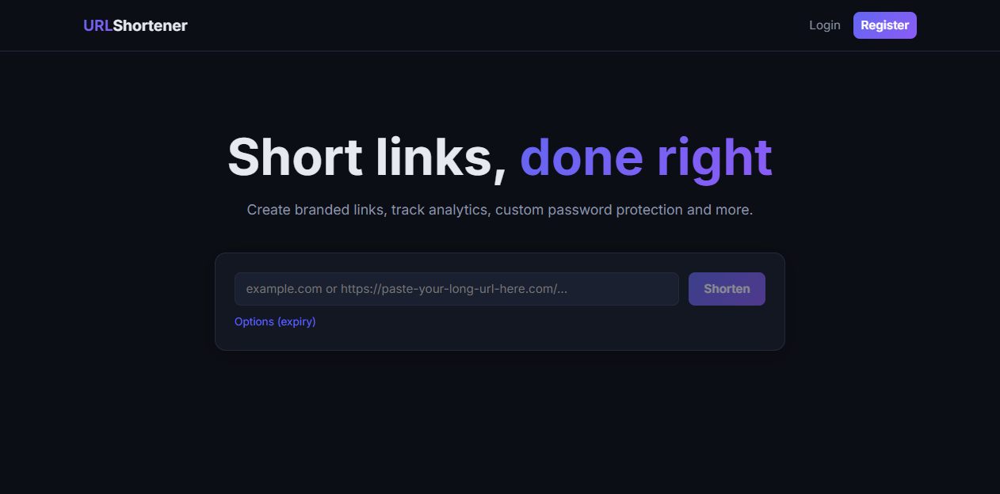

## What it can do

### Accounts and links

- Users can create an account and manage their own shortened links.

- Authentication uses opaque session tokens stored in Redis.

- Guest users can also create links, but guest links expire after 7 days. Guests cannot create custom aliases or password protected links.

### Custom links

A link can optionally have:

- A custom alias
- An expiration date
- Password protection
- A custom domain

### Password protected links

Password protected links display a server-side password page before the user is redirected.

The destination URL is not included in the page, so it is not exposed before the password is verified.

After entering the correct password, the visitor receives a signed cookie that remembers the verification for 24 hours.

### Analytics

Every redirect generates a click event.

Instead of writing analytics data directly during the redirect, the event is published to a Redis Stream. A background consumer processes the events and stores the data in PostgreSQL.

This keeps the redirect path relatively lightweight.

The application tracks things such as:

- Total clicks
- Approximate unique visitors
- Referrers
- Devices
- Browsers

Unique visitors are counted using HyperLogLog. The result is approximate, but it requires significantly less memory than storing every visitor individually.

### QR codes

Each shortened link has a QR code endpoint.

The generated QR code is aware of the domain being used so links created on a custom domain generate QR codes pointing to that domain.

### Admin features

Administrators have access to a separate management area where they can:

- View platform statistics
- Search links globally
- Manage users
- Suspend users
- Delete links when necessary
- View an audit log of administrative actions
- Export audit data as CSV

### Custom domains

Users can register custom domains and verify ownership using a DNS TXT record.

There is also an option for an administrator to approve a domain manually.

When a user visits the application through a verified custom domain, newly created short links use that domain as their base URL.

## Architecture

The backend follows a hexagonal architecture.

The main idea is to keep the business logic independent from frameworks and infrastructure.

The project is roughly divided into:

- **Domain** : business rules and domain models
- **Application** : use cases and application services
- **Ports** : interfaces used to communicate with external systems
- **Adapters** : implementations for PostgreSQL, Redis, HTTP, DNS, and other infrastructure

The domain layer does not depend on Spring or other framework specific code. ArchUnit tests are used to check these architectural rules during the build.

## Caching

The redirect flow uses multiple levels of caching.

The application first checks a Bloom filter to quickly reject short codes that are definitely not known. If the Bloom filter says the code might exist, the application checks:

1. Caffeine
2. Redis
3. PostgreSQL

When a link is found in the database, the caches are updated.

The Bloom filter was mainly included as an experiment. For a small application, it probably does not provide enough benefit to justify the additional complexity. It becomes more interesting when dealing with a much larger number of links and many requests for invalid codes.

## Rate limiting and abuse protection

The application includes several protections against abuse.

Redirect requests use a token bucket implemented with Redis. Other write operations use simpler fixed window limits.

Guest users also have a daily limit on the number of links they can create.

URLs are checked for potential SSRF issues when they are created. The destination is checked again before redirecting because DNS records can change after a URL has been stored.

DNS verification results are cached to avoid performing unnecessary lookups.

## Running it

Docker is all you need:

```bash
docker compose up -d --build
```

This starts PostgreSQL, Redis, the backend, an nginx hosted frontend on port 80, and Jaeger for traces.

## What I learned

The project gave me a chance to work with several things that I had previously only read about or used in smaller examples.

The parts I found particularly interesting were:

- Bloom filter
- Designing the application around ports and adapters
- Building a multilevel caching strategy
- Processing analytics asynchronously
- Using HyperLogLog for approximate unique counts
- Implementing rate limiting
- Handling SSRF related URL validation
- Keeping architectural boundaries enforced with ArchUnit

Not every decision here would necessarily make sense for a production URL shortener of every size. The goal of the project was partly to build something useful, but also to experiment with these ideas and understand where they make sense.


## Screenshots

<p align="center">
  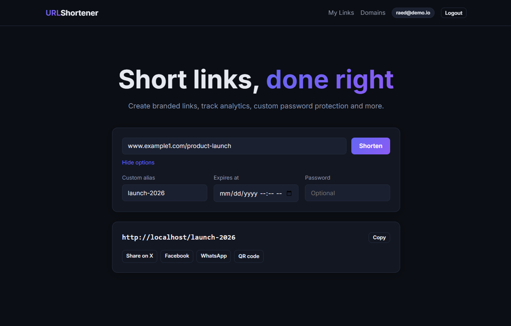
  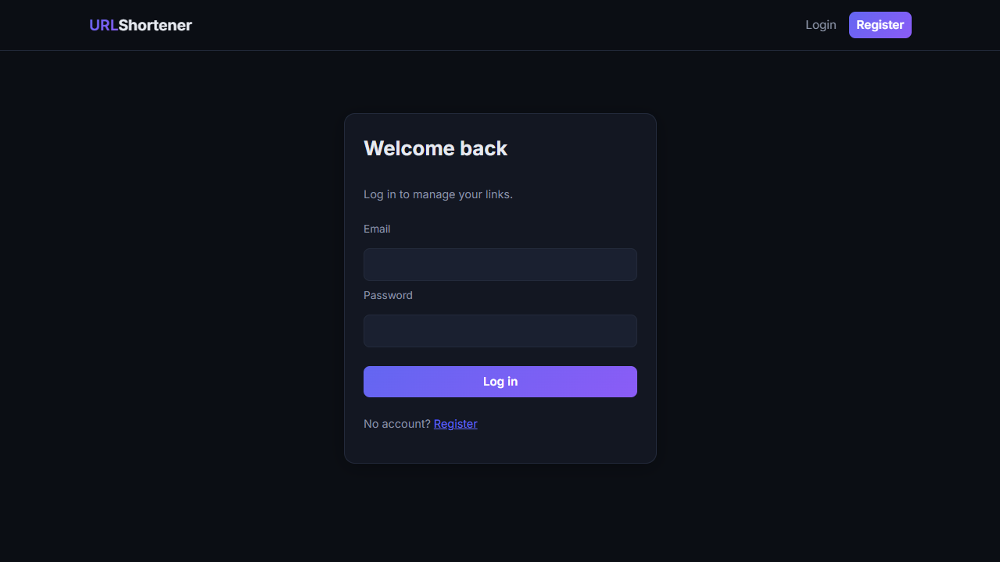
  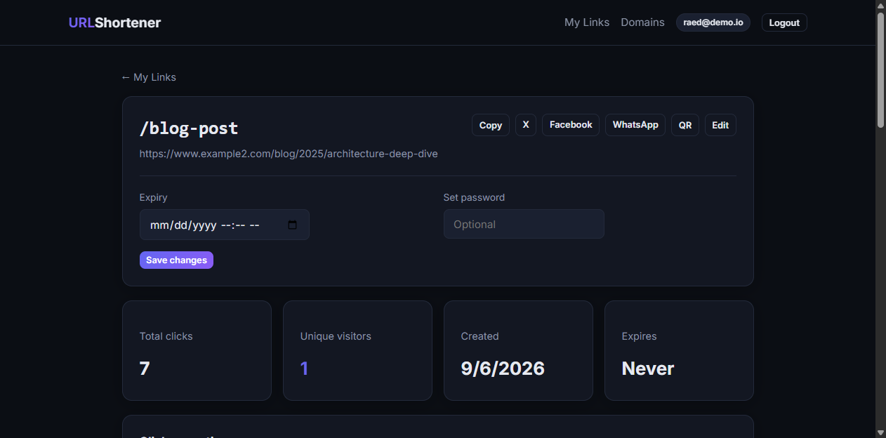
  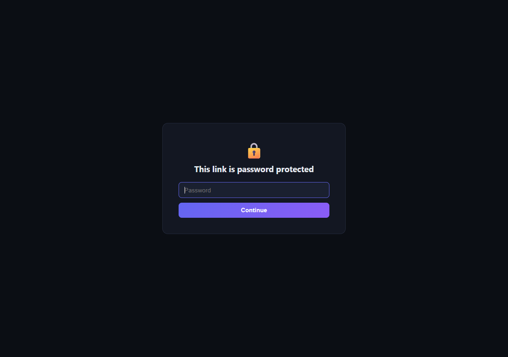
  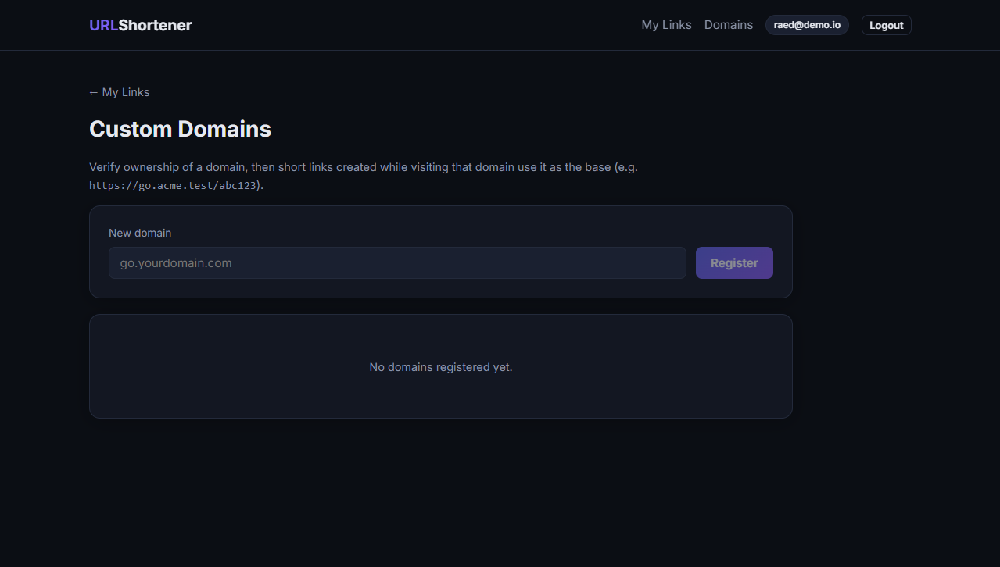
  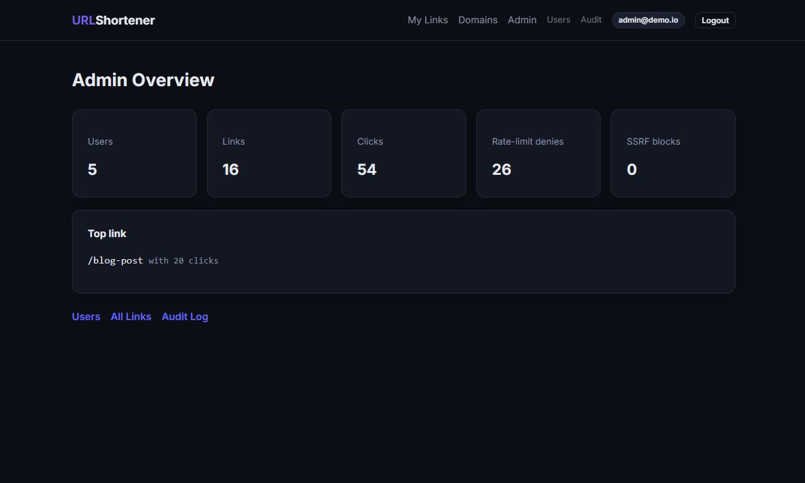
  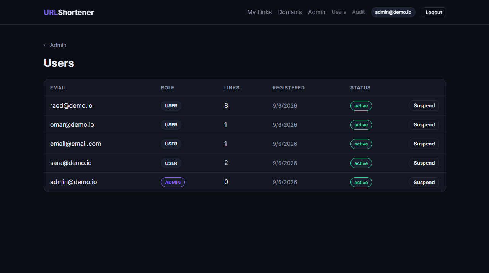
  
  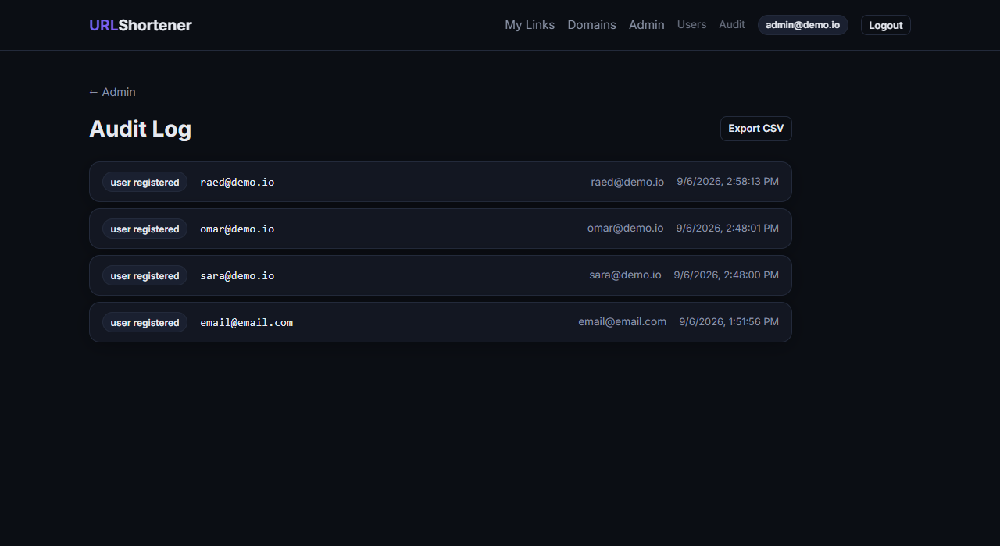
  
  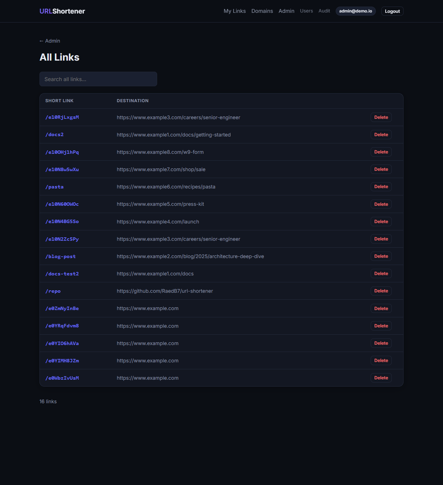
  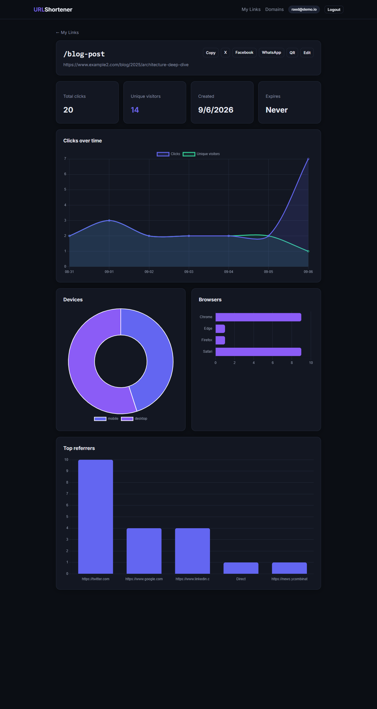
</p>
